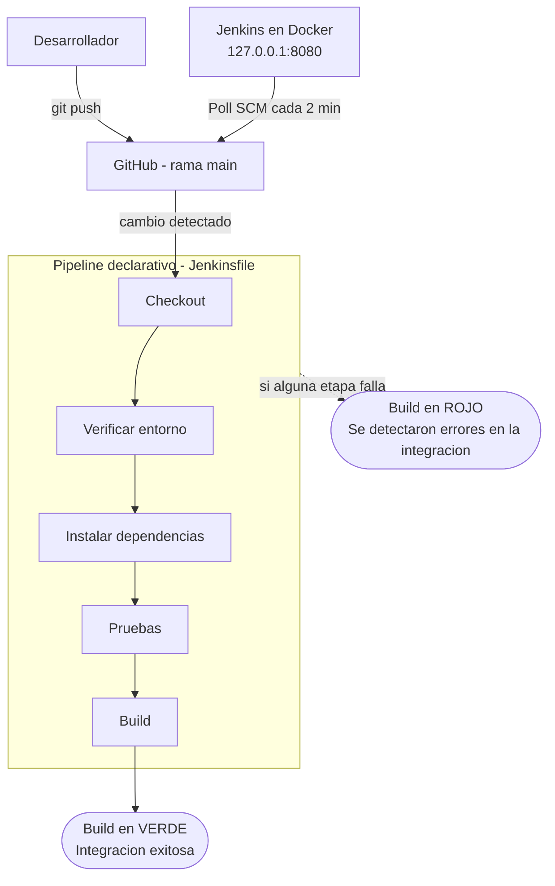

# Fase 2. Diseño del pipeline de Integración Continua

## 1. Etapas del proceso de integración

1. **Desarrollo aislado.** Cada funcionalidad se desarrolla en su propia rama (`feature/tareas`, `feature/calculadora`, `feature/conversor`) creada desde `develop`. Antes de cada commit se ejecuta `npm test` localmente.
2. **Integración en `develop`.** Las ramas `feature/*` se fusionan en `develop` con `git merge --no-ff`, lo que conserva en el historial el punto exacto de integración de cada módulo. Después del merge se ejecutan de nuevo `npm test` y `npm start`.
3. **Liberación a `main`.** Cuando `develop` es estable, se fusiona en `main` con `--no-ff` y se sube a GitHub.
4. **Detección del cambio.** Jenkins consulta el repositorio cada 2 minutos (Poll SCM) y detecta los commits nuevos en `main`.
5. **Ejecución del pipeline.** Jenkins ejecuta en orden las etapas del `Jenkinsfile`: Checkout, Verificar entorno, Instalar dependencias, Pruebas y Build.
6. **Retroalimentación.** El build termina en verde ("Integracion exitosa") o en rojo ("Se detectaron errores en la integracion"), y la consola de Jenkins muestra la etapa y la prueba exacta que fallaron.

## 2. Actividades automatizadas

| Actividad | Quién la ejecuta | Comando o mecanismo |
|---|---|---|
| Detección de cambios en el repositorio | Jenkins | `pollSCM('H/2 * * * *')` |
| Descarga del código fuente | Jenkins | `checkout scm` |
| Verificación de versiones del entorno | Jenkins | `node -v && npm -v` |
| Instalación de dependencias | Jenkins | `npm install` |
| Ejecución de pruebas unitarias | Jenkins | `npm test` (`node:test`, 13 pruebas) |
| Generación del artefacto | Jenkins | `npm run build` (carpeta `dist/`) |
| Reporte del resultado | Jenkins | Bloque `post` (`success` / `failure`) |
| Historial de builds y etapas | Jenkins | Pipeline: Stage View |

## 3. Herramientas

| Herramienta | Función en el proyecto |
|---|---|
| Git | Control de versiones local, ramas `main`, `develop` y `feature/*`, y merges `--no-ff` |
| GitHub | Repositorio remoto público y fuente que consulta Jenkins |
| Node.js / npm | Entorno de ejecución de la app y ejecución de los scripts `start`, `test` y `build` |
| Docker | Ejecuta Jenkins en un contenedor aislado y reproducible, publicado solo en `127.0.0.1:8080` |
| Jenkins | Servidor de integración continua que detecta cambios y ejecuta el pipeline |
| VS Code | Editor para escribir el código, las pruebas y el `Jenkinsfile` |

## 4. Diagrama del pipeline

### 4.1 Diagrama en texto

```
Desarrollador --(git push)--> GitHub (main)
                                   ^
                                   | Poll SCM cada 2 min (consulta saliente)
                                   |
                     Jenkins en Docker (127.0.0.1:8080)
                                   |
                                   v
 Checkout -> Verificar entorno -> Instalar dependencias -> Pruebas -> Build
                                   |
              +--------------------+--------------------+
              |                                         |
   Alguna etapa falla                        Todas las etapas pasan
   Build en ROJO                             Build en VERDE
   "Se detectaron errores en la integracion" "Integracion exitosa"
```

### 4.2 Diagrama en Mermaid



## 5. Justificación del diseño

### 5.1 Por qué un flujo lineal

Elegimos un pipeline secuencial de cinco etapas porque se ajusta a las características de la aplicación:

- **Aplicación modular y ligera.** `gestion-ci-app` no tiene dependencias externas y sus tres módulos (tareas, calculadora y conversor) son independientes y pequeños. No hay compilación pesada ni servicios externos que justifiquen etapas paralelas o agentes distribuidos.
- **Pruebas unitarias rápidas.** Las 13 pruebas con `node:test` se ejecutan en milisegundos. Dividirlas en ramas paralelas añadiría complejidad sin ahorrar tiempo.
- **Cada etapa depende de la anterior.** No tiene sentido instalar dependencias sin código, ni generar el build si las pruebas fallan. El orden lineal hace que el pipeline se detenga en el primer error (fail fast) y que el build roto nunca llegue a la etapa Build.
- **Diagnóstico inmediato.** Con Stage View se ve en qué etapa falló el build. Como cada módulo tiene su propio archivo de pruebas, la consola señala el módulo y la prueba exactos.
- **Fácil de mantener.** El `Jenkinsfile` vive en el repositorio y se versiona junto con el código, así que cualquier cambio al proceso queda registrado en Git.

### 5.2 Por qué Poll SCM en lugar de webhook

Un webhook exige que GitHub envíe una petición HTTP a Jenkins. Para eso Jenkins tendría que estar accesible desde internet, ya sea abriendo un puerto en el router o usando un túnel como ngrok. Eso expondría el servidor de CI, que tiene acceso al código y a credenciales, a ataques externos.

Con Poll SCM la comunicación es solo saliente: Jenkins consulta GitHub cada 2 minutos con un token de solo lectura. Esto permite:

- Mantener Jenkins publicado únicamente en `127.0.0.1:8080`, sin puertos abiertos ni túneles.
- Usar una credencial con permisos mínimos (token fine-grained con `Contents: Read-only`).
- Funcionar detrás de cualquier red doméstica o universitaria, sin configurar el router.

El costo es una latencia máxima de unos 2 minutos entre el `git push` y el inicio del build, que es aceptable para un proyecto académico de este tamaño. La `H` en `H/2 * * * *` reparte la consulta dentro del intervalo para no sobrecargar a Jenkins ni a GitHub.
